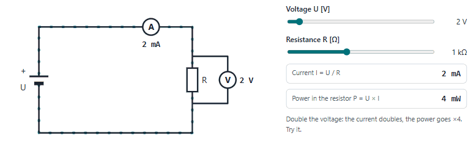
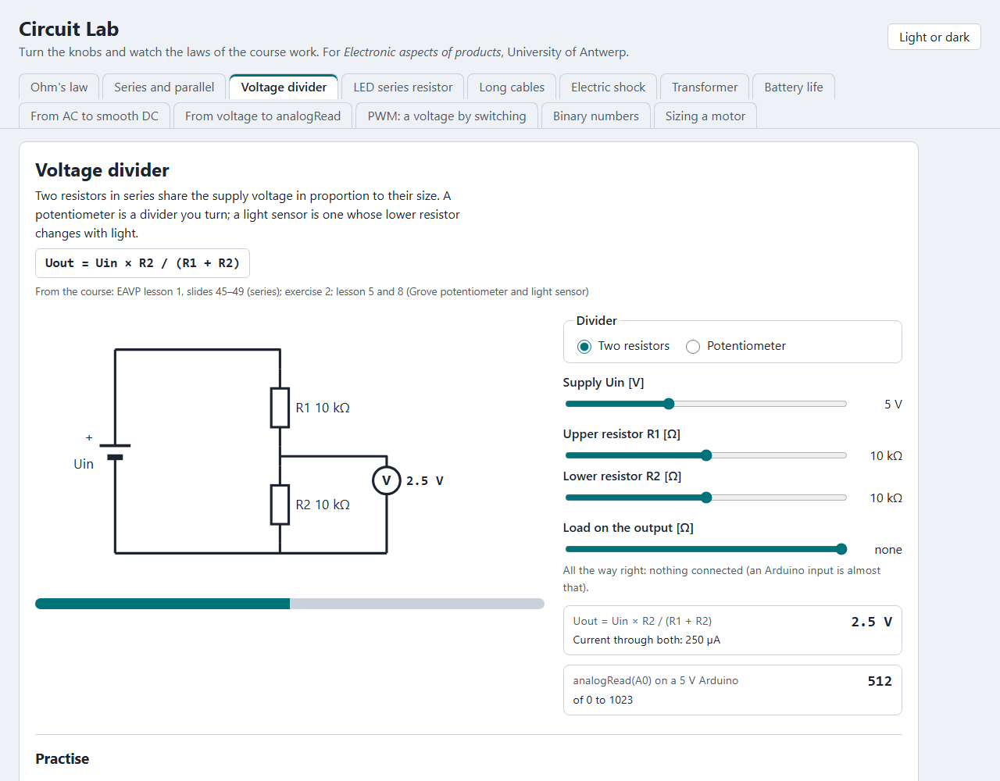
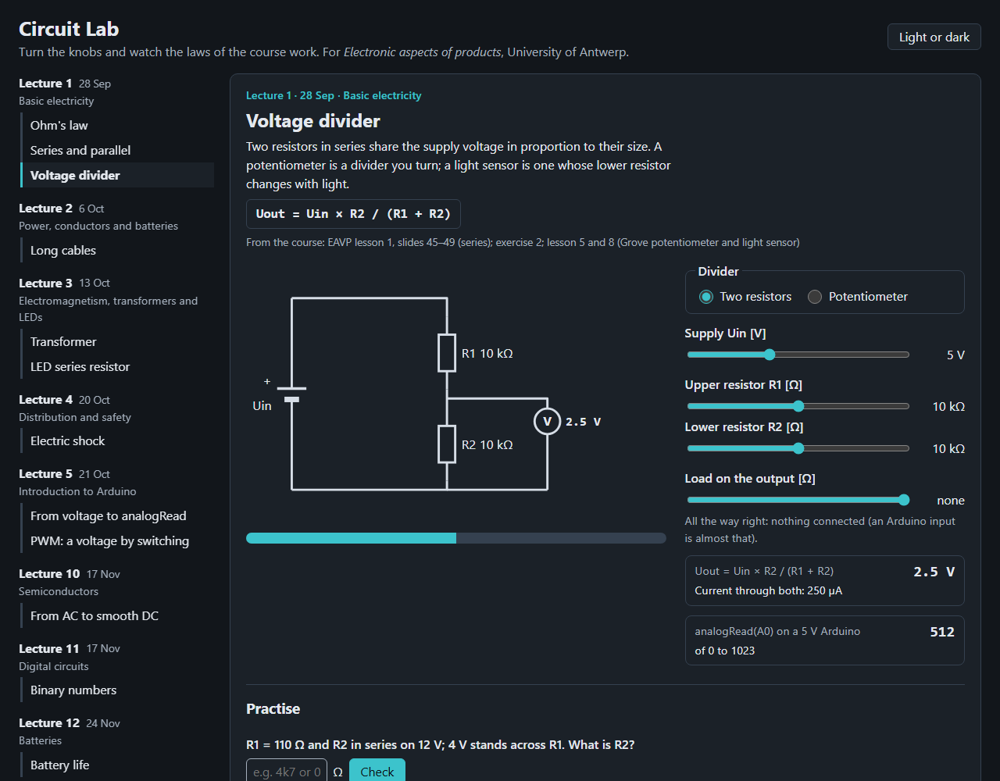

# Circuit Lab

Play with the laws of the course *Electronic aspects of products* (University of Antwerp): turn a knob, and the circuit,
the meters and the numbers follow. Made by the [SMART Lab](https://github.com/UA-SMARTLab) beside the
[Grove Kit Emulator](https://ua-smartlab.github.io/arduino-grove-emulator/).

**Open it:** https://abdulhamid-baghdadi.github.io/circuit-lab/

<p align="center">
  <picture>
    <source media="(prefers-color-scheme: dark)" srcset="docs/ohm-dark.gif">
    
  </picture>
</p>
<p align="center"><sub>Raise the voltage, lower the resistance: the current follows, and the resistor warns when it would burn. Plays once, 5 s.</sub></p>

<p align="center">
  
  
</p>

## The labs

The labs are cards, grouped by the lecture that teaches them, in the course's order, with the date and title from each
lecture's first slide. Each lab is one idea of the course, with the law, where in the course it comes from, a circuit to play with, and
practice questions from the course's own exercise sheet, checked as you type them ("22.5m" is read as 22.5 mA).

| Lecture | Lab | What you do |
|---|---|---|
| 1 · 28 Sep · Basic electricity | Ohm's law | Turn U and R; the current, the meters and the dots on the wire follow; the resistor warns when it gets too hot |
|  | Series and parallel | Wire three resistors three ways and watch the course's table method fill in, with its checks |
|  | Voltage divider | Two resistors or the kit's potentiometer; add a load and see it pull the output down; the number analogRead would give |
| 2 · 6 Oct · Power, conductors and batteries | Long cables | Pouillet's law: how much of 230 V reaches a load 700 m away on 6 mm² |
|  | Real batteries | Four cells in series, parallel or two by two, each with a little resistance inside; the voltage at the load sags |
| 3 · 13 Oct · Electromagnetism, transformers and LEDs | Measuring U and I | Put the ammeter and the voltmeter in series or across R; a wrong place shows as a short or as nothing flowing |
|  | Using a multimeter | Pick what to measure, the red lead's socket and the range; the display reads, shows OL, or the fuse blows |
|  | Transformer | Change the windings; the voltage, the currents, and the line loss at high and low voltage follow |
|  | LED series resistor | Pick the colour, supply and current; get the resistor, the one you can buy, and what really flows |
| 4 · 20 Oct · Distribution and safety | RMS and peak | Set the RMS voltage; see the wave reach √2 times higher, as 230 V mains peaks at 325 V |
|  | Electric shock | Your body as a resistor: where you stand and what you touch, against the lesson's table of effects |
|  | Energy bill | Power × hours × price for one device; the same heat bought with an electric heater, a heat pump or gas |
| 5 · 21 Oct · Introduction to Arduino | The breadboard | Click holes and see which are joined inside; place a part's legs and see whether it bridges two strips or is shorted |
|  | Pull-down resistor | A button on D2 with no resistor, a pull-down or a pull-up; watch the open pin read at random |
|  | From voltage to analogRead | The voltage on A0, the 10-bit staircase, `map()` and the servo turning |
|  | PWM: a voltage by switching | `analogWrite` as a square wave, its duty and average, and an LED dimming |
| 7 · 28 Oct · Variables, functions and serial | Variable types and overflow | Store a number in byte, int or long on the UNO R3 or R4 and watch it wrap; typecasting examples |
| 8 · 3 Nov · Sensors | Temperature sensor (NTC) | Warm the lecture's NTC; its resistance, the divider's voltage, analogRead, and the temperature worked back |
| 9 · 4 Nov · Advanced Arduino programming | State machine | The lecture's traffic light: states, events and transitions, stepped through with its switch-case code |
|  | Mixing colours | Three sliders 0–255 mix a NeoPixel colour, with its code and the 16 777 216 colours |
| 10 · 17 Nov · Semiconductors | From AC to smooth DC | No diode, one diode or a Graetz bridge, then a capacitor: the wave, its average and its ripple |
|  | Transistor as a switch | Pin 9 through a base resistor switches an LED strip; the base current against the pin's limit, on or half on |
|  | Opamp circuits | Without feedback, non-inverting, inverting or difference amplifier: the resistors set the gain, the supply limits the output; lecture 10's ×4 table as a difference amplifier |
|  | Lowering a voltage | An LM7805 from 12 V: the heat it burns, its efficiency, and a switching converter beside it |
| 11 · 17 Nov · Digital circuits | Number bases | One number in decimal, binary, octal and hexadecimal; binary addition with its carries |
|  | Binary numbers | Flip bits; see the place values, the two's complement reading and the flash ADC's comparators |
|  | Logic gates | Flip two inputs, pick a gate; the output, its row of the truth table and the same test in Arduino code |
|  | Shift register | Set the data pin, pulse the clock, latch; or shiftOut a byte: eight outputs from three pins |
|  | From number to voltage (DAC) | Flip three bits; the lecture's DAC steps down from 0 V, its staircase and the feedback resistor |
|  | Button bounce | One press of a bouncing button counted raw and with the course's 50 ms debounce |
| 12 · 24 Nov · Batteries | Battery chemistries | Each chemistry's cell voltage, cells in series for a voltage, and a LiPo's safe window |
|  | Battery life | Cell type, cells in series, capacity and load: hours, Wh and the cost of a charge |
|  | Battery budget | The lecture's sensor node: measuring, idle and sending, the mAh a year and how many years 5200 mAh lasts |
| 13 · 1 Dec · Motors | Sizing a motor | Mass, height and time give the ideal power; a safety factor gives the motor to buy |
|  | Stepper or servo | Send steps to a stepper under load and see it lose position without knowing; the servo gets there |

Every answer on the exercise sheet is recomputed by the program in the tests, so a typo in the data fails the build.

## Open it on your own PC

The page needs a web server because it reads `data/labs.json`. In this folder:

```bash
python -m http.server 8765 --bind 127.0.0.1
```

then open http://127.0.0.1:8765. Nothing is sent anywhere; there is no account and no tracking.

## How it is made

```
src/core   the laws, the converter and the units: pure functions, tested headless
src/ui     sliders, readouts, circuit symbols, the cards' line art: knows no law
src/labs   one file per lab, joining the two, with its card picture; listed in src/labs/index.js
src/app.js reads data/labs.json and lays out the lectures with their labs
```

Plain JavaScript modules, no framework and no build step; GitHub Pages serves the folder as it is. The layers and the
check that holds them: [ARCHITECTURE.md](ARCHITECTURE.md). Tests: `node --test "tests/unit/*.test.js"`.

## Limits

- Every number, example and claim in the labs comes from the course files (with the lecture and slide or page), follows
  from them by definition or arithmetic, or is established physics stated exactly. Generalisations, typical values and
  made-up models were taken out after a fact check: [docs/fact-check.md](docs/fact-check.md).
- Ideal parts: no tolerances, no temperature effects, an LED at a fixed voltage, an ideal converter. Measure on the
  real kit too.
- Two drawn illustrations remain and say so on screen: the moving dots in Ohm's law, and the example bounce in the
  button-bounce lab (the course gives no bounce times).
- Values between the points of lecture 8's NTC table are interpolated, and the lab says so.

## Licence

The code is under the [MIT licence](LICENSE). The course's exercises and slides belong to their authors and are
cited, not copied.
